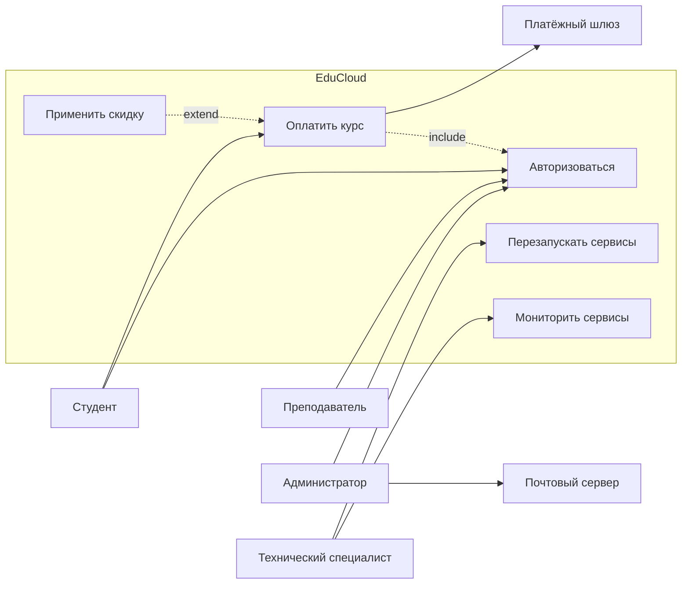
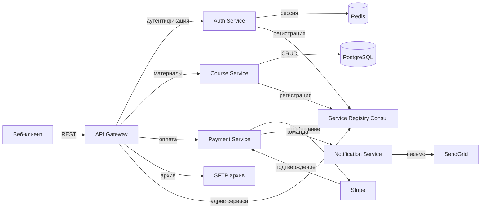
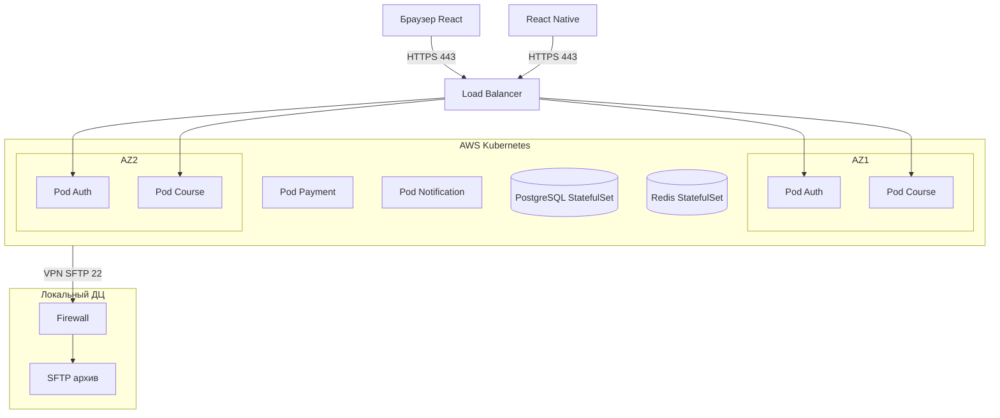
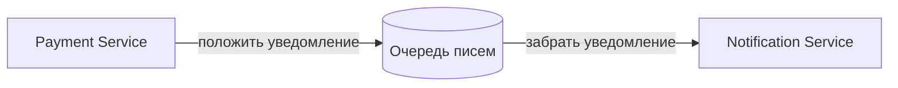

# Лабораторная работа № 1. Архитектура облачных и гибридных ИС

Дисциплина: Защита ПО автоматизированных систем. Файл методички: «Лаба 1 ЗПО.pdf».

## Цель

Собрать три диаграммы по одному сценарию EduCloud: варианты использования, потоки данных и развертывание. Рисовал в файлах, которые открываются локально: SVG смотрится прямо на GitHub, `.excalidraw` открывается в Excalidraw через Open. На сайт excalidraw.com для сдачи не опираюсь, ссылку преподавателю не оставлял.

## Сценарий

EduCloud — платформа онлайн-обучения. Снаружи веб на React и мобильное приложение на React Native. Внутри четыре сервиса: Auth (JWT), Course, Payment, Notification. Пользователи и курсы лежат в PostgreSQL, сессии в Redis. Сервисы крутятся в Kubernetes в AWS. Архив лекций — на SFTP в локальном дата-центре, перед ним firewall, до облака только VPN. Деньги уходят в Stripe, письма в SendGrid. Перед сервисами стоит API Gateway.

## Ход работы

### Варианты использования

Граница системы — прямоугольник «Система онлайн-обучения EduCloud». Внутри неё сценарии, снаружи актёры.

Актёры: Студент, Преподаватель, Администратор, Технический специалист. За границей — Платёжный шлюз и Почтовый сервер.

Студент: авторизоваться, просмотреть курсы, скачать материалы, оплатить курс, просмотреть архивные лекции. Преподаватель: авторизоваться, загрузить материал, обновить курс, просмотреть статистику. Администратор: авторизоваться, управлять пользователями, управлять платежами. Технический специалист: мониторить сервисы и перезапускать их. Это самостоятельное задание, на диаграмме он фиолетовый.

Пунктир `<<include>>` идёт от остальных сценариев к «Авторизоваться»: без входа эти действия не начинаются. `<<extend>>` идёт от «Применить скидку» к «Оплатить курс»: скидка не обязательна, она дополняет оплату.

Файлы: [diagrams/01-use-case.svg](diagrams/01-use-case.svg), [diagrams/01-use-case.excalidraw](diagrams/01-use-case.excalidraw).

### Потоки данных

Уровень 1: не одна коробка «система», а процессы по сервисам. Стрелки подписаны глаголом. Синий — внутренний обмен, зелёный — клиенты и внешние API, оранжевый — гибридный архив.

Веб и мобильный клиент отдают REST в API Gateway и получают ответ. Gateway запрашивает аутентификацию у Auth, материалы у Course, оплату у Payment. Auth пишет и читает сессию в Redis. Course пишет курсы в PostgreSQL. Payment отправляет требование в Stripe и получает подтверждение, затем просит Notification отправить письмо. Notification зовёт SendGrid. Архивные лекции Gateway забирает с SFTP в локальном ДЦ.

Service Registry (Consul) добавлен отдельно. Auth и Course регистрируют свой адрес, Gateway перед вызовом спрашивает, куда идти, и получает адрес. Жёстких IP в потоке нет.

Файлы: [diagrams/02-dfd.svg](diagrams/02-dfd.svg), [diagrams/02-dfd.excalidraw](diagrams/02-dfd.excalidraw).

### Развертывание

Три узла. Клиенты: браузер и React Native. Локальный ДЦ: firewall и SFTP, порт 22, в интернет сервер не торчит. AWS: подпись Kubernetes. Снаружи только HTTPS 443 на балансировщик.

Балансировщик стоит перед двумя зонами. В AZ1 и в AZ2 по реплике Auth и Course, порт 8080. Payment и Notification тоже поды. PostgreSQL и Redis — StatefulSet, порты 5432 и 6379, белого IP нет. Из AWS в ДЦ линия подписана как VPN.

Файлы: [diagrams/03-deployment.svg](diagrams/03-deployment.svg), [diagrams/03-deployment.excalidraw](diagrams/03-deployment.excalidraw).

## Ответы на контрольные вопросы

1. Для пользователя граница use case — вся EduCloud, один прямоугольник. В монолите за этой границей тоже одна система, но внутри нет отдельных сервисов, которые надо стыковать. На use case микросервисы я не рисовал: студент не вызывает Auth напрямую. Сервисы видны на DFD и на развертывании.

2. DFD уровня 1. Контекстная диаграмма была бы одной коробкой и внешними актёрами, по ней не видно Stripe, Redis и архива. Нулевой уровень тоже слишком крупный. Здесь каждый сервис — процесс, у баз свои хранилища.

3. Асинхронный обмен через очередь рисуется отдельным хранилищем, не стрелкой «сразу в сервис». Payment кладёт сообщение в очередь, Notification забирает его позже. На моей диаграмме оплата и письмо пока синхронные: Payment сам вызывает Notification. Если вынести это в RabbitMQ, между ними появляется хранилище «очередь писем» и две стрелки: «положить уведомление» и «забрать уведомление».

4. Гибрид режется сетью. С интернета открыт только 443 на балансировщик. PostgreSQL и Redis без белого адреса. SFTP не публикуется: до него AWS доходит по VPN, а перед архивом стоит firewall, порт 22 только из туннеля.

5. Состояние держат PostgreSQL, Redis и файлы на SFTP. Auth, Course, Payment, Notification и Gateway состояние запроса не хранят, сессия вынесена в Redis. Stateless можно ставить второй репликой за балансировщиком, как Auth и Course в двух зонах. Stateful так не клонируют: у PostgreSQL и Redis диск и StatefulSet, у архива один файловый сервер.

6. На deployment для Kubernetes единица запуска — Pod, а не виртуальная машина. Ноду выбирает планировщик, на схеме она не нужна. Кластер подписан один раз, внутри него поды и StatefulSet.

7. Без registry Gateway хранит адреса Auth и Course. С Consul эти сервисы сначала регистрируются, Gateway спрашивает адрес и только потом шлёт запрос. Поток «Gateway → сервис» остаётся, перед ним появляется «Gateway → registry».

## Вывод

На трёх диаграммах один и тот же EduCloud. Use case показывает, кто что делает, и не разбирает сервисы. DFD показывает, какие данные ходят между gateway, четырьмя сервисами, базами, Stripe, SendGrid и архивом. Deployment показывает, что это два контура: Kubernetes в AWS с двумя зонами и SFTP за VPN в локальном ДЦ.
