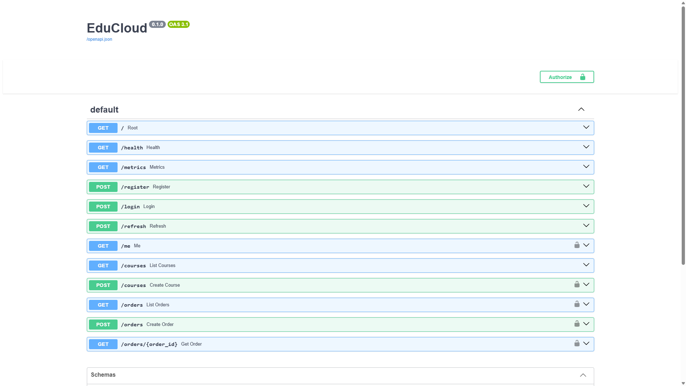

# Лаба 3. JWT

В материалах это файл «Лаба 4 ЗПО.pdf». По тексту работа № 3.

## Что сделал

Токены живут в учебном приложении `prilozhenie`. Страница, с которой я их проверял:

Отдельный разбор остался в `app/` этой папки. Без `SECRET_KEY` процесс не стартует, секрет в коде не подставляю. Файл `.env` в git не клал.

Пользователи в памяти. Пароль храню как pbkdf2-sha256 со своей солью, не открытым текстом. В задании был passlib, я взял hashlib: открытый пароль в базе всё равно не лежит.

Токен собираю сам, три части через точку, подпись HMAC-SHA256. Принимаю только `alg=HS256`. Если в заголовке другой алгоритм, токен отклоняю, способ подписи из заголовка не выбираю. Без `exp` тоже не пускаю. Access живёт `ACCESS_TOKEN_EXPIRE_MINUTES`, если не задано — 15 минут. Refresh — 7 дней.

Регистрация `POST /register`, роль `user` или `admin`. Вход формой на `/token` и JSON на `/token/custom`. Открытые адреса `/` и `/public-info`. `/protected` только с access. `/protected/admin` только для role admin, иначе 403. В ответах нет хеша пароля.

Refresh при обмене и при logout кладу в чёрный список. `POST /token/revoke-all` увеличивает `token_version`, старые refresh с другим `ver` больше не проходят. Смена пароля увеличивает и этот счётчик, и `password_version`. В access записан `pwd`. После смены пароля старый access на `/protected` даёт 401. `revoke-all` access не трогает, по заданию он гасит refresh.

С одного IP больше 10 запросов за минуту на `/register`, `/token` и `/token/custom` дают 429. Это счётчик в памяти, для лабы хватает.

Коллекция: `postman/jwt.postman_collection.json`. Сверху вниз: публичные, регистрация, вход, protected без токена, с токеном, refresh, logout, refresh после logout, admin от обычного пользователя.

## Вопросы

1. В JWT три части: заголовок, нагрузка, подпись. Первые две — base64url от JSON, третья — подпись от строки `header.payload`.
2. Access короткий, его шлю на каждый закрытый запрос. Refresh длинный и нужен только чтобы получить новую пару.
3. Конкретный refresh гашу чёрным списком. Пачку — счётчиком `token_version`. После смены пароля ещё и access, через `pwd`.
4. Нельзя верить `alg` из токена и нельзя принимать токен без `exp`. У меня алгоритм зашит, срок проверяется.
5. Ключ в проде лежит в secret manager и приезжает переменной окружения. В git его нет.
6. В httpOnly-cookie скрипт страницы токен не прочитает. Из localStorage прочитает. К cookie ещё Secure и SameSite.
7. CORS только на свой фронт, без звёздочки. Это ограничение браузера, не замена проверке токена.
8. На `/token` и `/register` без лимита можно перебирать пароли и плодить учётки. У меня 10 запросов в минуту с одного IP.

## Вывод

Сделал вход с парой токенов, чёрный список и отзыв всех refresh одним счётчиком. После смены пароля старый access тоже перестаёт работать. Без `SECRET_KEY` сервис не запускается.
