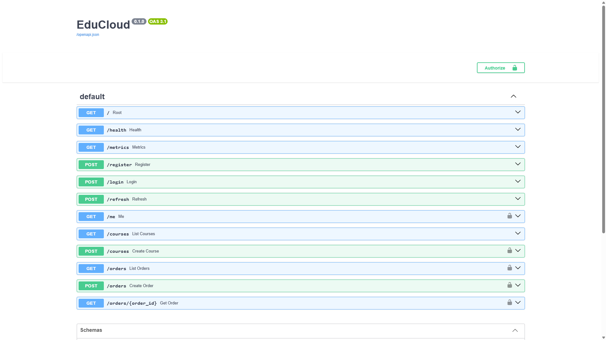

# Практика 3. FastAPI и Postman

## Что сделал

Рабочий сервис — каталог курсов в `prilozhenie`. Документация с машины:



Старый набросок пользователя остался в `user_service/`, дальше я перенёс то же на EduCloud: регистрация, вход, курсы и заказы.

Запуск:

```
cd user_service
pip install -r requirements.txt
copy .env.example .env
```

В `.env` свой `JWT_SECRET`. Потом `uvicorn main:app --reload`. Рядом `python notify_service.py`, порт 8001.

Есть `GET /`, `GET /health`, создание и список пользователей, получение по id, обновление и удаление. Email уникальный. В списке есть `skip`, `limit` и `min_age`: если возраст задан, отдаю только тех, у кого age больше порога. Без age в фильтр не попадают.

После создания пользователя сервис шлёт POST на `http://localhost:8001/notify/`. Если приёмник лежит, пользователь всё равно создаётся, в лог пишется ошибка.

`PUT` и `DELETE` без токена дают 401. Токен выдаёт `POST /login` после `POST /signup`. Пароль храню как pbkdf2 со случайной солью, токен собираю сам: HMAC-SHA256, в заголовке только HS256, есть `exp` на 60 минут. Если секрета нет, верный логин отвечает 500, чужой пароль всё равно 401.

`GET /users/{id}/posts` сначала проверяет, что пользователь есть, потом ходит на jsonplaceholder. Нет пользователя — 404, внешний сервис не ответил — 502.

Коллекция Postman: `user_service/postman/user_service.postman_collection.json`. Её гонял сверху вниз: создание, список, карточка, update без токена, signup, login, update с Bearer, delete, posts.

На pydantic 2 сериализация через `model_dump()`, не `.dict()`.

## Вопросы

1. У FastAPI схемы и документация появляются из типов. На Flask это надо собирать отдельно.
2. Pydantic проверяет тело запроса и не пускает кривой JSON, FastAPI отдаёт 422.
3. В Postman: Body → raw → JSON, потом Send. Смотрю код и тело ответа.
4. Исходящий вызов — `httpx.AsyncClient` внутри `async def`.
5. Ошибку notify ловлю и пишу в лог. Создание пользователя из-за этого не откатываю.
6. Документация на `/docs`. Там видно маршруты и можно их дёрнуть.
7. Повторный DELETE уже удалённого id даёт 404.

## Вывод

Собрал CRUD, фильтр по возрасту и отдельный приёмник уведомлений. Закрыл изменение и удаление токеном. Посты читаются снаружи только если пользователь уже есть локально.
