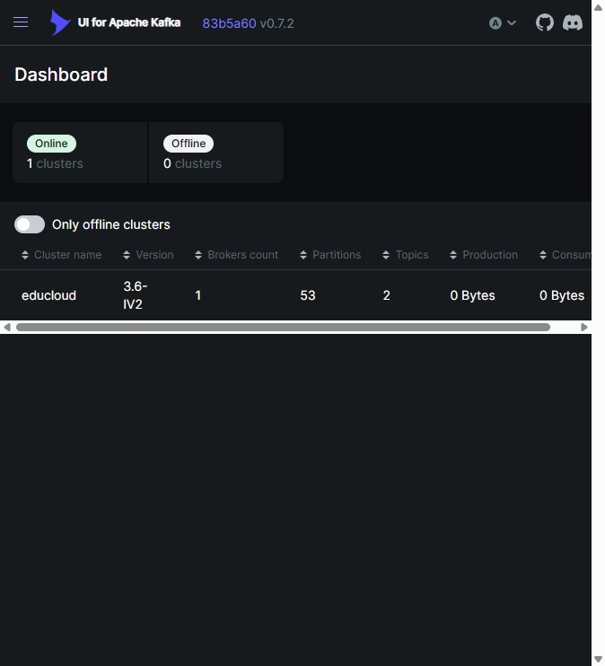
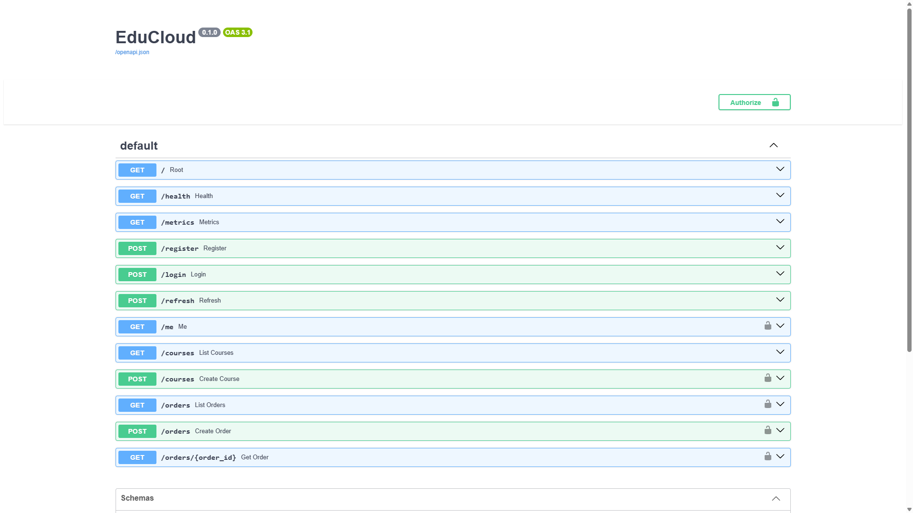

# EduCloud

Маленький каталог курсов: API и отдельный консьюмер.
Пользователи, курсы и заказы живут в памяти API. Перезапустил процесс — списки пустые, для стенда это нормально.

Kafka необязательна. Нет адреса брокера — заказ всё равно сохраняется, в топик ничего не шлётся.
Консьюмер в этом случае просто стартует и на `/health` отвечает `degraded`.

## Пакеты

Ставлю в виртуальное окружение, из папки приложения. Глобально в систему не сыплю.

```powershell
cd C:\abobus\univer_stuff\studydevops2026\prilozhenie
python -m venv .venv
.\.venv\Scripts\Activate.ps1
pip install -r requirements.txt
```

## Ключ

```powershell
copy .env.example .env
```

Открываю `.env` и вписываю `SECRET_KEY`. Пока ключ пустой, API не стартует: дефолтный секрет я не подставлял.
`KAFKA_BOOTSTRAP` оставляю пустым, пока брокер не поднят. С хоста это `localhost:9094`, из контейнера `kafka:9092`.
`ENABLE_DOCS=1` оставляет страницу `/docs`. Значение `0` её выключает.
Непустая переменная окружения важнее файла: если `SECRET_KEY` уже задан в системе, строка из `.env` его не перебьёт.

Команды uvicorn ниже запускаю из `prilozhenie`, иначе Python не найдёт пакет `api`.

## Два процесса

```powershell
uvicorn api.main:app --host 127.0.0.1 --port 8000
```

Второй терминал, то же окружение:

```powershell
uvicorn consumer.main:app --host 127.0.0.1 --port 8001
```

Стек из compose: брокер, UI, Postgres, Redis, RabbitMQ. Кластер в UI онлайн.



Документация, когда API уже запущен:



API: http://127.0.0.1:8000/health — в ответе `{"status":"ok"}`. Корень `/` отдаёт короткое имя сервиса.
Каждый запрос API пишет в этот терминал одну JSON-строку. Счётчики лежат на http://127.0.0.1:8000/metrics
При пустом `KAFKA_BOOTSTRAP` у консьюмера `/health` будет `degraded`, список заказов пустой.
Когда брокер есть, консьюмер читает топик `orders` группой `orders-group`. Список: http://127.0.0.1:8001/orders
Если адрес брокера указан, но он молчит, заказ в API всё равно создаётся (ответ 201), а в логе будет ошибка. Ответ может занять несколько секунд.

## Регистрация и вход

```powershell
curl.exe -s -X POST http://127.0.0.1:8000/register -H "Content-Type: application/json" -d '{"username":"anya","email":"anya@example.com","password":"secret","role":"teacher"}'
```

```powershell
curl.exe -s -X POST http://127.0.0.1:8000/login -H "Content-Type: application/json" -d '{"username":"anya","password":"secret"}'
```

В логине приходят `access_token`, `refresh_token` и `token_type`. Дальше заголовок `Authorization: Bearer` и сам access-токен.
Без `role` регистрация создаёт `user`. Курсы читаются без токена: `GET /courses`. Создать курс может только `teacher`.
Заказ — `POST /orders` с телом `{"course_id": 1}`. Чужой заказ по id не отдаётся.
С одного IP больше 10 POST суммарно на `/login` и `/register` за минуту — ответ 429.

Образ в `Dockerfile` запускает API на порту 8000 от пользователя с uid 1000.
Команда консьюмера написана там же одной строкой комментария, сам консьюмер я поднимаю второй командой uvicorn.
